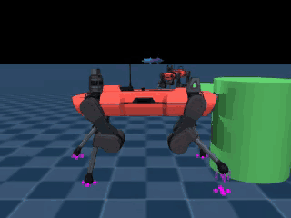
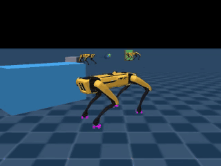
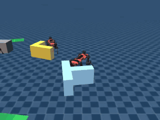
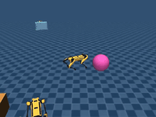

# QuadCoop

Reinforcement learning (PPO) in MuJoCo for single- and multi-agent object pushing with
two different quadrupeds, **ANYmal C** (~50 kg) and **Spot** (~33 kg). Each robot first
learns to walk under load, then to push objects to a goal pose. The two then learn to
push heavy objects together, which lets us compare **IPPO** (one critic per robot) with
**MAPPO** (a shared, centralized critic) and treat coordination as a game. Built on
[mjlab](https://github.com/mujocolab/mjlab) (MuJoCo Warp), 4096 parallel environments
per run.

## Stage 1: Force Walk

| ANYmal C | Spot |
|---|---|
|  |  |

**Training.** PPO learns a joint-level walker that tracks a commanded velocity
`(vx, vy, ωz)` in any direction. In 75% of episodes, objects of 3–30 kg are placed in
the robot's path and must be pushed through. The other 25% are free walking with
changing commands. The heaviest allowed object grows with a curriculum. Falling ends
the episode.

**Observations (48).** Base linear and angular velocity (IMU), gravity direction, joint
positions and velocities, last action, velocity command. The critic also sees foot
contacts and heights.

**Actions (12).** Joint position targets.

**Rewards.** Velocity tracking and progress along the command, pushing the touched
object along the command, gait (foot air time), base height and smoothness, posture,
foot clearance and slip, and penalties on action rate.

## Stage 2: Goal Guidance

| ANYmal C | Spot |
|---|---|
|  |  |

**Training.** The Stage 1 walker is frozen. A high-level PPO policy steers it, 50 times
a second, to push an object to a goal pose (green). Success means within 10 cm and 6°
of the goal, held for 1 s. There are ten objects (cube, box, sphere, cylinder, beam, L,
T, standing arch, dumbbell, split-friction box) of 5–40 kg. A 6-level curriculum grows
the goal distance (up to 7 m), the goal's direction and heading change, the object mass,
and how precisely it must be placed.

**Observations (42), in the robot's frame.** Base velocity and gravity direction,
object position, heading and velocity, goal position relative to the robot and to the
object, heading error, current walker command, last action, an object description
(size, centre of mass, symmetry, rolls or not), and hold progress. The critic also sees
object mass, friction and curriculum level.

**Actions (3).** Velocity command `(vx, vy, ωz)` for the frozen walker.

**Rewards.**
- Object progress toward the goal, being near it, heading progress and alignment.
- Approaching the object and getting behind it.
- Being inside the goal, holding it there, and a sharp precision bonus for the last few
  centimetres and degrees.
- Penalties: the object moving fast near the goal, the object running away, action
  changes, falls (−20).

## Stage 2a / 2b: Shape Profiles (in progress)

Stage 2 with the object's shape as an image, so the policy can handle shapes it has not
seen. Seven shapes are trained (cube, long box, sphere, cylinder, arch, dumbbell, T) with
sizes randomized ±20% per environment; beam, L, U-channel, plus and the split-friction box
are held out. Profiles are signed-distance images computed exactly from the object's
geometry (no rendering):

- **2a:** a top view of the object at body height (32×32, object frame) and a front
  silhouette (16×32).
- **2b:** a top map around the robot (32×32, robot frame, the object where it actually is,
  like an ideal 2D scan) refreshed at 10 Hz, plus the front silhouette.
- **Control:** the same task and training with the 42 Stage 2 inputs only.

Each image goes through a small CNN whose features join the 42 inputs. Training starts
from the Stage 2 policy with the image weights at zero, so it starts out behaving exactly
like Stage 2. Shapes that are failing get practised more, and the approach reward
measures distance to the object's surface. Evaluation covers seen shapes, sizes outside
the training range and unseen shapes, plus ablations (object heading reported as 0,
images zeroed or swapped between objects) that show whether the policy uses each input.

## Stage 3: Cooperative Push (in progress)

Both robots keep their frozen walkers. Each robot's policy starts from its Stage 2
policy and also sees its partner's position, heading and velocity. They share one team
reward for pushing objects of 10–120 kg, beyond what one robot can move. IPPO and MAPPO
differ only in the critic: IPPO gives each robot its own critic on its own
observations, MAPPO gives them one critic over both. We evaluate each robot alone,
both untrained policies together, and the trained pair on the same tasks.

## Running

```bash
bash slurm/setup_engaging.sh && source .venv/bin/activate          # one-time setup
ROBOT=anymal_c sbatch slurm/train_walker.sbatch                     # Stage 1
ROBOT=anymal_c sbatch slurm/train_push_v2.sbatch                    # Stage 2
ROBOT=anymal_c STAGE=1c sbatch slurm/eval_push.sbatch               # Stage 2 evaluation
ROBOT=anymal_c sbatch slurm/check_push2.sbatch                      # Stage 2a/2b input checks
VARIANT=a ROBOT=anymal_c sbatch slurm/train_push2.sbatch            # Stage 2a (b, ctrl likewise)
VARIANT=a ROBOT=anymal_c sbatch slurm/eval_push2.sbatch             # Stage 2a/2b evaluation + ablations
sbatch --array=0-5 slurm/train_coop.sbatch                          # Stage 3: MAPPO + IPPO, 3 seeds each
RUN=mappo_seed0 sbatch slurm/eval_coop.sbatch                       # Stage 3 evaluation
```
Use `ROBOT=spot` for Spot.