# QuadCoop

## Goal

A team of different legged robots (**ANYmal C** and **Spot**) that work on shared tasks and decide for themselves **when to help and when not to**:

- **Help** when a job is too much for one robot, such as an object too heavy to push alone.
- **Stay out** when one robot can manage, so the other is free for other work.
- **Account for each robot's type:** size, strength and how hard it can push.

The test task is pushing objects (20–80 kg, 12 shapes) to a goal position and heading.

**Where we are:** two ANYmal C robots pushing together, with a planner that assigns where each one pushes. Next: mixed ANYmal + Spot teams, and learning when a second robot is needed.

<p align="center">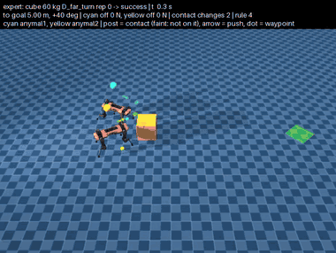<br>
<em>Current system: two ANYmal C push a 60 kg cube 3 m and turn it to the goal (green). 5× speed.</em></p>

Built on [mjlab](https://github.com/mujocolab/mjlab) (MuJoCo Warp) with PPO / MAPPO, 4096 parallel environments per run.

## How it fits together

```
 contact planner ──► contact executor (RL, per robot) ──► walker (RL, frozen) ──► joints
 "who pushes where"   velocity command (vx, vy, wz)         50 Hz
```

| Step | What is learned | Status |
|---|---|---|
| [1. Walker](#1-walker) | Walk at a commanded velocity, push through objects | done (v1) |
| [2. Single-robot push](#2-single-robot-push) | Steer the walker to push an object to a goal pose | done |
| [3. Learned cooperation](#3-learned-cooperation-mappo--ippo) | Two robots, end-to-end MAPPO / IPPO | dropped |
| [4. Contact planner + executor](#4-contact-planner--executor) | Assign contacts, then reach and press them | **current system** |
| [5. Walker issues and fixes](#5-walker-issues-and-fixes) | Why heavy pushes fail, and what fixed it | in progress |
| 6. Mixed teams: when to help | ANYmal + Spot, decide whether a second robot is needed | next |

---

## 1. Walker

| ANYmal C | Spot |
|---|---|
| 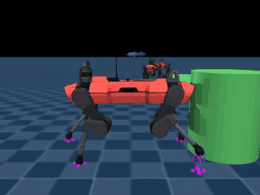 | 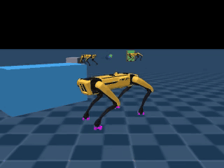 |

- Joint-level PPO policy tracking `(vx, vy, wz)`; objects of 5–30 kg placed in its path.
- 48 inputs (IMU, gravity, joints, last action, command) → 12 joint targets.
- Frozen and reused by every later step.

## 2. Single-robot push

| ANYmal C | Spot | Unseen shape (plus) |
|---|---|---|
| 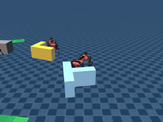 | 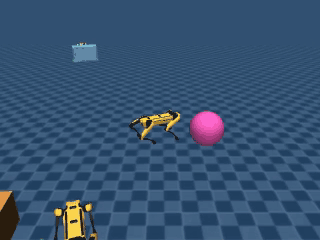 | 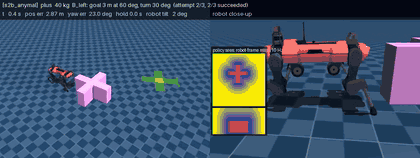 |

- High-level policy sends velocity commands to the frozen walker to push an object to a goal pose (10 cm / 6°).
- Stage 2b adds a 32×32 top-down map of the object, so it handles shapes it was not trained on.
- ANYmal C: **0.79** success over seen and unseen shapes at 10–40 kg ([evals](evals/README.md)).

## 3. Learned cooperation (MAPPO / IPPO)

| Two single-robot policies collide | MAPPO still times out at 80 kg |
|---|---|
| 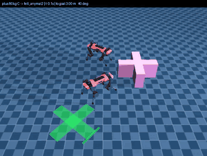 | 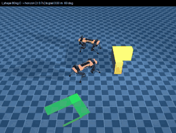 |

| Success by mass | 20 kg | 40 kg | 60 kg | 80 kg |
|---|---|---|---|---|
| one robot | 0.89 | 0.60 | 0.27 | 0.11 |
| two single-robot policies | 0.65 | 0.51 | 0.40 | 0.18 |
| MAPPO | 0.88 | 0.76 | 0.47 | 0.20 |
| IPPO | 0.91 | 0.80 | 0.49 | 0.20 |

Indicative: evaluation setups differ slightly from Step 4.

**Takeaway:** training together removes the collisions, but the robots rarely push at the same time, so heavy objects still fail. Next step: make *where each robot pushes* explicit.

## 4. Contact planner + executor

<p align="center">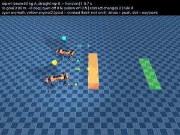<br>
<em>Main failure: a timeout. The beam ends 9 cm / 7° from the goal; the last degrees of turning never come.</em></p>

- A planner picks a contact point on the object for each robot (re-planned about 9× per episode).
- An RL executor per robot walks to its contact and presses (Stage 4, `turn_debug` checkpoint).

| Success by mass | 20 kg | 40 kg | 60 kg | 80 kg | episodes with a fall |
|---|---|---|---|---|---|
| **current system** | 0.67 | 0.67 | 0.57 | **0.38** | 6% |

**Takeaway:** heavy objects nearly double vs MAPPO (0.20 → 0.38). Most losses are timeouts: when told to push, robots are off the object 40–60% of the time.

## 5. Walker issues and fixes

Investigating why heavy pushes stall led back to the walker.

| Issue | Finding | Decision |
|---|---|---|
| Force-tracking ("compliant") walkers v2–v22 | Ran at the joint-torque limit (up to 100% of the time); none beat v1 in the pair | dropped |
| Brace posture | A static LP and a whole-body sim show the normal stance holds as much force as a brace | dropped (figure below) |
| Feet creep in simulation | MuJoCo soft contacts let planted feet slide at 12–400 mm/s *below* the friction limit | elliptic friction cone, `impratio 10`: 0.6–6 mm/s |
| Grippy feet → falls | The executor sends saturated commands (0.94 m/s + 0.7 rad/s), outside what the walker was trained on | **command interface** (below) |

<details><summary>Brace posture study (click)</summary>

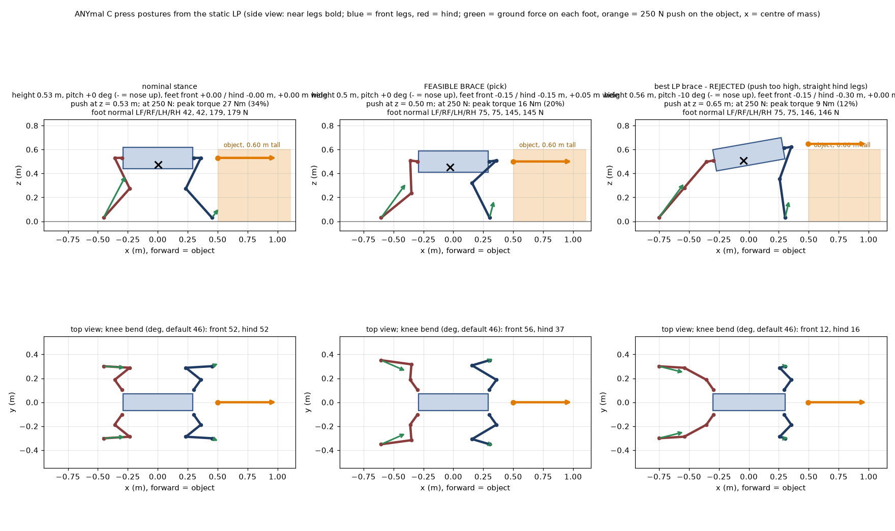

</details>

**Falls happen only outside the walker's trained command range.** From 255 robot-minutes of traces: 0 falls inside the range, 14 per robot-hour outside, almost all during diagonal or backward moves with fast turning right after leaving a contact.

**Fix:** cap combined speed at 0.7 m/s and turning at 0.4 rad/s (0.3 on a contact) before the walker.

| Raw commands: falls 11 cm from the goal | Capped commands: same task, done in 12.6 s |
|---|---|
| 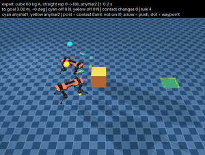 | 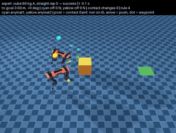 |

| Grippy feet, same executor (48 tasks per mass) | 20 kg | 40 kg | 60 kg | 80 kg | episodes with a fall |
|---|---|---|---|---|---|
| raw commands | 0.65 | 0.69 | 0.50 | 0.33 | 21% |
| **capped** | 0.75 | 0.73 | 0.46 | 0.29 | **6%** |
| capped + rate-limited | 0.58 | 0.54 | 0.42 | 0.27 | 6% |
| *current system (slippery feet)* | 0.73 | 0.77 | 0.56 | 0.31 | 7% |

**Takeaway:** capping alone brings falls back to the current system's level at the same success; rate limiting only adds lag. The executor was trained on the old commands, so it is now being fine-tuned with the cap.

**In progress:** executor fine-tunes (`logs/marl2/ftx_*`) with capped and capped + rate-limited commands, plus an equal-budget control on the current system.

---

## Running

```bash
bash slurm/setup_engaging.sh && source .venv/bin/activate   # one-time setup
ROBOT=anymal_c sbatch slurm/train_walker.sbatch              # 1. walker (ROBOT=spot for Spot)
ROBOT=anymal_c sbatch slurm/train_push_v2.sbatch             # 2. single-robot push
ALGO=mappo sbatch slurm/train_coop2.sbatch                   # 3-4. pair training (recipes in the file header)
PREFIX=my-eval RULES=expert ARGS="--executor stage4 --checkpoint logs/keep/marl2/turn_debug/model_15000.pt --start behind" \
  sbatch slurm/contact_test.sbatch                            # 4. pair evaluation
WALKERS="v1=<model.pt>" sbatch slurm/walker_test.sbatch      # walker acceptance test
```

Options used above: `QUADCOOP_CONTACT=nocreep` (grippy feet), `QUADCOOP_CMD_IF=proj` (command cap). Evaluation summaries live in [evals/](evals/).
