# QuadCoop

Teams of legged robots (ANYmal C, Spot) that push heavy objects to a goal position and heading together, and decide
when a task needs more than one robot.

<table>
<tr>
<td align="center">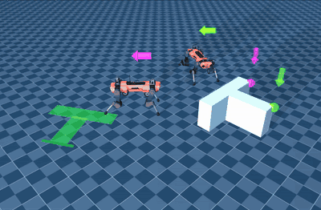<br><sub><b>2 robots</b>: T shape, 80 kg, goal behind on the right (4×)</sub></td>
<td align="center">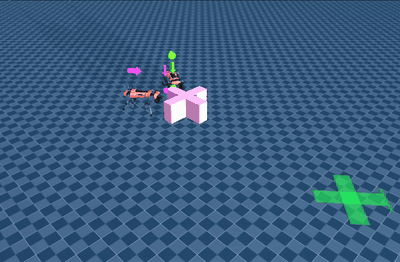<br><sub><b>2 robots</b>: plus, 80 kg, 5 m with a 90° turn (6×)</sub></td>
</tr>
<tr>
<td align="center">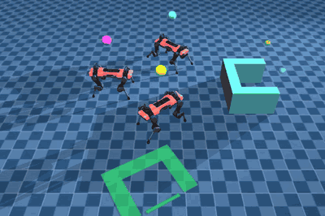<br><sub><b>3 robots</b>: U channel, 80 kg, goal behind on the right (4×)</sub></td>
<td align="center">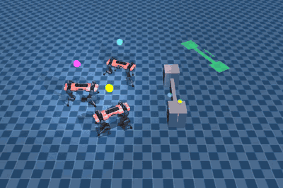<br><sub><b>3 robots</b>: dumbbell, 80 kg, goal 60° left (4×)</sub></td>
</tr>
</table>

<sub>Contact planner + learned executor. The green patch is the goal pose. Arrows and posts mark each robot's assigned
contact. In the three-robot clips the helper (magenta ball) joins once the planner judges the pair too weak for the object.</sub>

**The task:** push one of 12 objects (cube, long box, sphere, cylinder, arch, dumbbell, T, beam, L, split-friction box,
U channel, plus) at 20–120 kg to within 10 cm and 6° of a goal pose, from four starts: 3 m straight, 3 m at 60° left,
3 m behind on the right, or 5 m with a 90° turn. Built on [mjlab](https://github.com/mujocolab/mjlab) (MuJoCo Warp),
thousands of parallel environments per run.

```
 team policy ─────────────────────────► walker (RL, frozen) ──► joints
 (MAPPO / IPPO, or                       velocity command          50 Hz
  contact planner + per-robot executor)  (vx, vy, wz)
```

---

## Building blocks: walker and single-robot pusher

| ANYmal C | Spot | One ANYmal pushing an unseen shape |
|---|---|---|
| 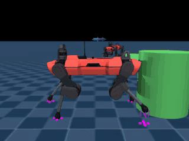 | 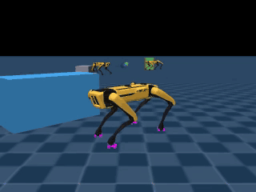 | 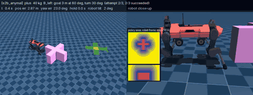 |

- **Walker:** a joint-level PPO policy that tracks a commanded velocity `(vx, vy, wz)` and keeps walking when it hits an
  object. It is trained once, frozen, and used by every team below.
- **Single-robot pusher:** sends velocity commands to the walker. It sees a 32 × 32 top-down map of the object, which
  lets it handle shapes it never trained on. Alone it manages 89% at 20 kg but only 11% at 80 kg, which is why the rest
  of the project is about teams.
- **Walker fix that matters for teams:** heavy-push falls came from team policies sending commands outside the
  walker's trained range. Capping combined speed at 0.7 m/s and turning at 0.4 rad/s cut falls from 21% to 6% with
  grippy feet.

---

## Learned teams: MAPPO and IPPO

Two robots trained end to end. MAPPO has a shared critic; IPPO trains each robot on its own. Both start from the
single-robot pusher and keep a **KL anchor** to it during training.

<table>
<tr>
<td align="center">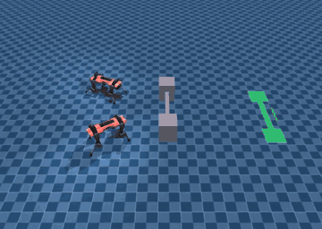<br><sub><b>MAPPO</b>: dumbbell, 80 kg, straight (4×)</sub></td>
<td align="center">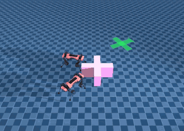<br><sub><b>MAPPO</b>: plus, 80 kg, goal 60° left (7×)</sub></td>
</tr>
<tr>
<td align="center">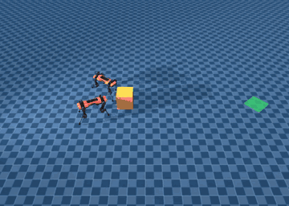<br><sub><b>IPPO</b>: cube, 80 kg, 5 m with a 90° turn (4×)</sub></td>
<td align="center">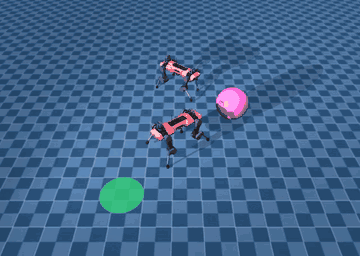<br><sub><b>IPPO</b>: sphere, 80 kg, goal behind on the right (2×)</sub></td>
</tr>
</table>

What goes wrong without joint training, without the anchor, and on heavy objects:

<table>
<tr>
<td align="center">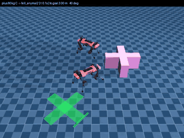<br><sub>Two single-robot pushers side by side, never trained together: they collide</sub></td>
<td align="center">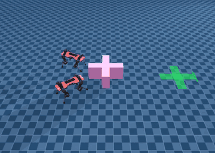<br><sub>MAPPO without the KL anchor: plus, 60 kg, a robot falls (1×)</sub></td>
<td align="center">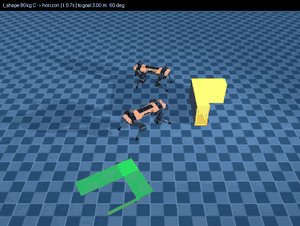<br><sub>MAPPO at 80 kg: the two rarely push at the same time, and the task times out</sub></td>
</tr>
</table>

- **The KL anchor is essential.** Without it the pair forgets how to push: MAPPO succeeds 35% of the time instead of 58%
  (+22.7 pp [+18.6, +26.9] with the anchor), and fading the anchor out during training gives 23% instead of 65%.
  The exact weight barely matters (0.02 and 0.05 tie; 0.2 is too strong).
- **Learned pairs are strong on light objects and weak on heavy ones** (benchmark table below). They rarely push at
  the same time, so heavy objects time out.
- **Adding a learned third robot hurts.** Copying the pair's actors to three robots and training together costs
  19–23 pp at 20–60 kg; only MAPPO gains at 80–120 kg, by +5.6 pp. Four-robot teams and no-KL teams are training now
  ([docs/marl_teams.md](docs/marl_teams.md)).

---

## Contact planner

A planner decides *where* each robot pushes; a learned executor per robot walks to that contact and presses.

<table>
<tr>
<td width="45%">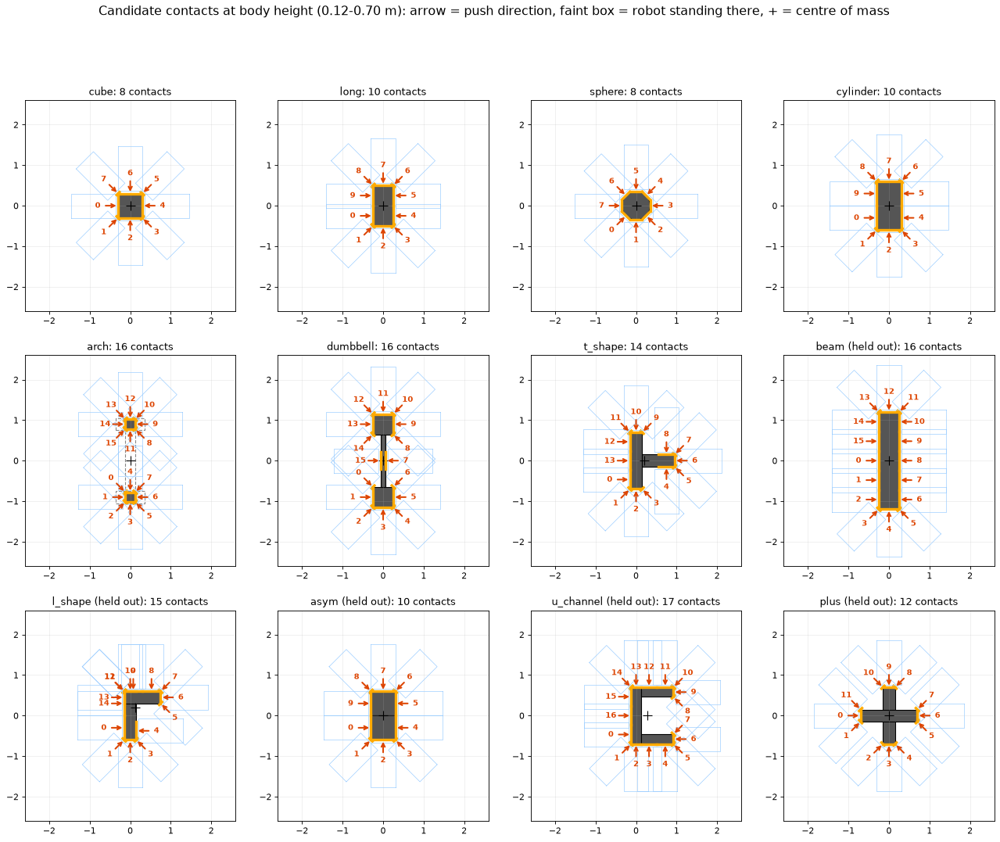</td>
<td>

- **Planner:** picks one contact per robot from a set of candidates on the object (left: arrows are push directions,
  faint boxes are where the robot stands), and re-plans about 9 times per episode.
- **Executor:** one RL policy per robot. It walks to the assigned contact, presses, and turns the planner's push
  direction into walker commands.
- **Why:** it makes the robots push at the same time, which the learned pairs rarely do.

</td>
</tr>
</table>

<table>
<tr>
<td align="center">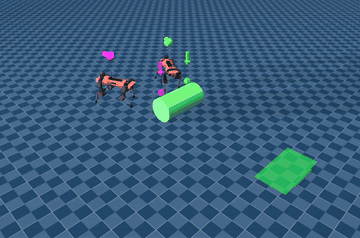<br><sub>Cylinder, 80 kg, straight (2×)</sub></td>
<td align="center">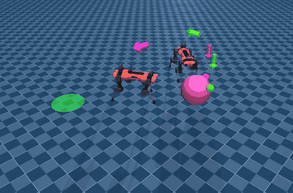<br><sub>Sphere, 80 kg, goal behind on the right (2×)</sub></td>
<td align="center">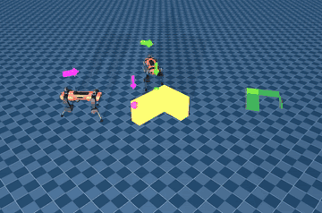<br><sub>L shape, 80 kg, goal 60° left (4×)</sub></td>
</tr>
</table>

<p align="center">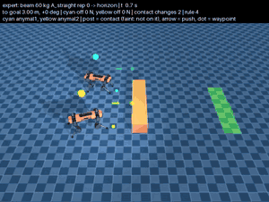<br>
<sub>The typical failure is a timeout: here the beam ends 9 cm / 7° from the goal; the last degrees of turning never come.</sub></p>

### Benchmark: every method on the same tasks

12 objects × 4 starts × 10 trials per mass, 80 s limit
([evals_present/00_overview](evals_present/00_overview/comparison_all_systems.md)).

<table>
<tr>
<td width="48%">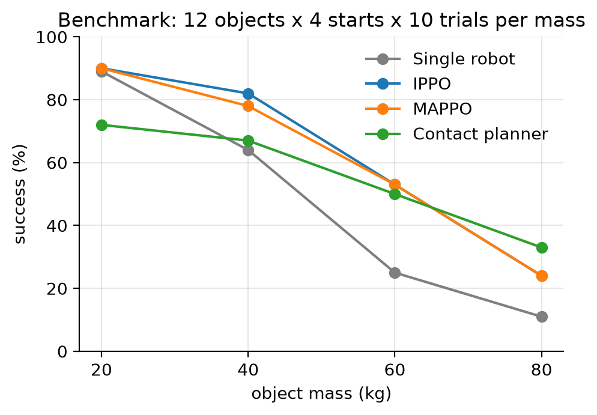</td>
<td>

| success | 20 kg | 40 kg | 60 kg | 80 kg | episodes with a fall |
|---|---|---|---|---|---|
| single robot | 89% | 64% | 25% | 11% | 10% |
| IPPO pair | **90%** | **82%** | **53%** | 24% | 16% |
| MAPPO pair | **90%** | 78% | **53%** | 24% | 16% |
| contact planner | 72% | 67% | 50% | **33%** | **8%** |

</td>
</tr>
</table>

- **The planner wins where it matters:** at 80 kg it succeeds 33% of the time against 24% for the learned pairs,
  and it falls half as often (8% vs 16% averaged over masses; 17% vs 26–27% at 80 kg).
- **It is slower on light objects** (34 s vs 25 s to succeed on average): it re-plans and repositions where a learned
  pair would just push.
- **Most of its failures are timeouts,** usually the last few degrees of a turn. The extensions below target that.

---

## Contact planner extensions

### 1. More robots: when does a third or fourth help?

Branched trees: the same two-robot episode is copied mid-push and continued as two robots, with robot 3 called at 8 s,
or with robot 4 called at 20 s. 5 seeds × 120 tasks per point, 20–100 kg.

<p align="center">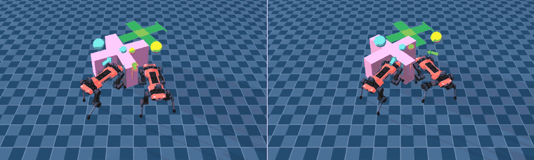<br>
<sub><b>2 vs 3</b>, plus, 100 kg, the same episode from 16 s (5×). Left: the pair continues and succeeds at 45.9 s.
Right: robot 3 (magenta) is called at 20 s and the trio succeeds at 38.9 s.</sub></p>

<p align="center">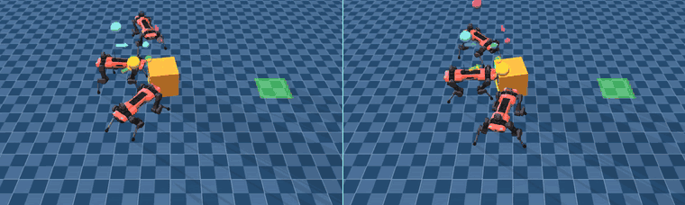<br>
<sub><b>3 vs 4</b>, cube, 80 kg, the same episode from 16 s (6×; ends just after the trio finishes). Left: three robots
succeed at 49.6 s. Right: robot 4 (orange) is called at 20 s; the four crowd the cube and time out 8 cm short.</sub></p>

<table>
<tr>
<td width="48%">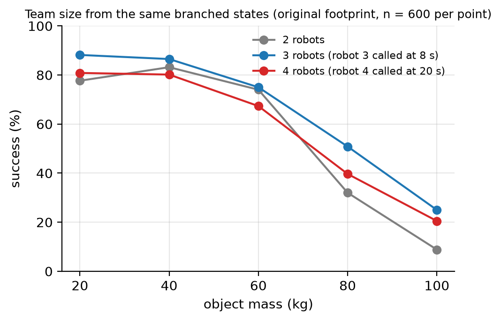</td>
<td>

| success | 2 robots | 3 robots | 4 robots |
|---|---|---|---|
| original objects | 55.1% | **65.1%** | 57.7% |
| footprint × 1.5 | 26.6% | **51.7%** | 45.7% |

</td>
</tr>
</table>

- **A third robot helps,** most at 80–100 kg (+16 to +19 pp) and even more on larger objects (+25 pp at × 1.5).
- **A fourth robot hurts** at every mass, by about 7 pp. Placing robot 4 directly at its contact instead of walking it
  in changes nothing (+0.8 and −0.3 pp). The other three robots push less once it joins (89 N → 69 N), and robot 4
  itself adds only 12 N.
- **Cases where four robots win** (about 5% of tasks) are no more common than the disagreement between two identical
  runs. **Rule: stay at three.**

### 2. Penalty after repeated failed pushes

The original planner keeps returning to contact pairs that are not moving the object. The penalty remembers a pair
that has failed in two 2 s windows and ranks it lower; progress halves the count.

Long box, 80 kg, turned 60° in place; the same placement for both:

<table>
<tr>
<td align="center">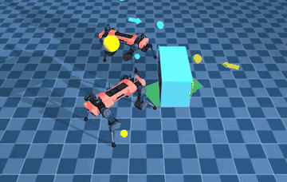<br><sub><b>Original planner</b>: keeps pushing the same diagonal corners and times out (8×)</sub></td>
<td align="center">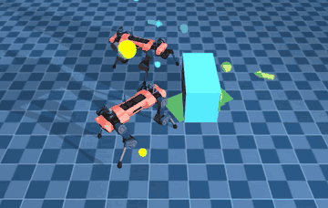<br><sub><b>With the penalty</b>: after two failed windows a robot moves to the long face and the box turns (7×)</sub></td>
</tr>
</table>

<table>
<tr>
<td width="48%">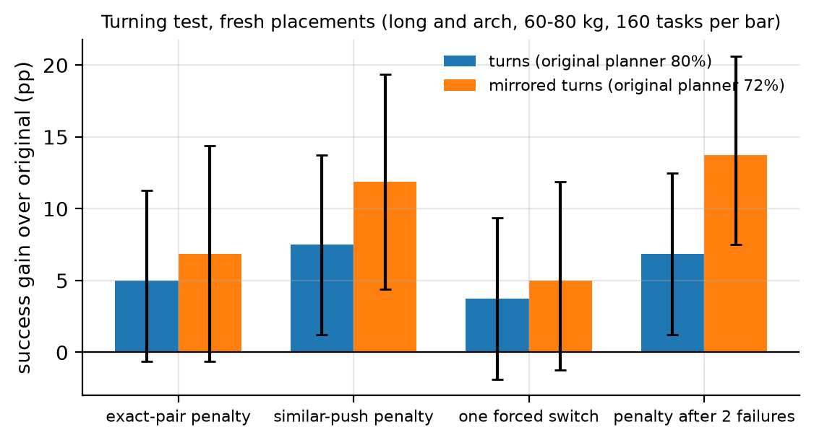</td>
<td>

- **Turning in place** (long box and arch, 60–80 kg, fresh placements, 160 tasks per bar): the penalty adds
  **+6.9 pp** on turns and **+13.8 pp** on mirrored turns (72.5% → 86.2%). The other penalty variants help too;
  forcing one switch is weakest.
- **Ordinary deliveries at 80 s:** no change (62.3% vs 62.4%). Within 80 s there is too little time left for the switch to pay off (next section).

</td>
</tr>
</table>

### 3. Longer time limit (80 s → 140 s)

<p align="center">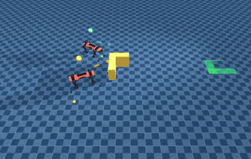<br>
<sub>L shape, 80 kg, 5 m with a 90° turn: delivered at 126 s, a task the 80 s limit would have counted as a failure (10×).</sub></p>

<table>
<tr>
<td width="48%">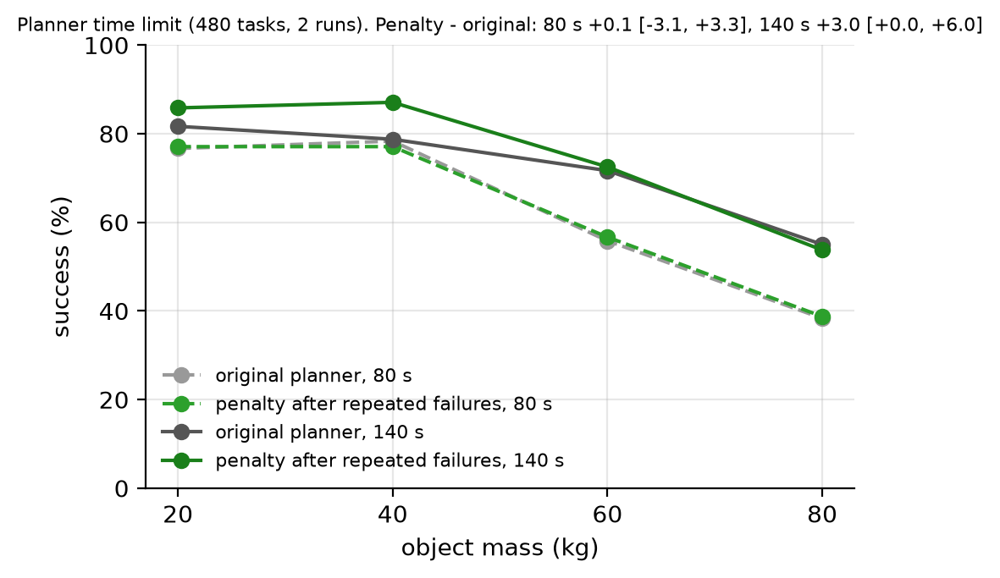</td>
<td>

| success (480 tasks, 2 runs) | 80 s | 140 s |
|---|---|---|
| original planner | 62.3% | 71.8% |
| with the penalty | 62.4% | **74.8%** |
| penalty − original | +0.1 | **+3.0** [+0.1, +6.0] |

- **Heavy objects were often slow, not stuck:** the extra 60 s adds about 16 pp at 60–80 kg.
- **The penalty only pays off with time to use it:** it ties at 80 s and leads by 3 pp at 140 s, mostly at 20–40 kg.
- Falls may rise slightly with the penalty at 140 s (6–8% vs 5–6%); not yet tested.

</td>
</tr>
</table>

---

## More

- **Figures and strips for every object and method:** [paper_media/README.md](paper_media/README.md) (rebuild with
  `python scripts/paper_media.py`).
- **Write-ups:** [docs/why_questions.md](docs/why_questions.md) (penalty, time limit, team size),
  [docs/marl_teams.md](docs/marl_teams.md) (learned teams, KL anchor),
  [docs/three_anymal.md](docs/three_anymal.md) (learned trios).

## Running

```bash
bash slurm/setup_engaging.sh && source .venv/bin/activate   # one-time setup
ROBOT=anymal_c sbatch slurm/train_walker.sbatch              # walker (ROBOT=spot for Spot)
ROBOT=anymal_c sbatch slurm/train_push_v2.sbatch             # single-robot pusher
ALGO=mappo sbatch slurm/train_coop2.sbatch                   # MAPPO / IPPO pairs (recipes in the file header)
PREFIX=my-eval RULES=expert ARGS="--executor stage4 --checkpoint logs/keep/marl2/turn_debug/model_15000.pt --start behind" \
  sbatch slurm/contact_test.sbatch                            # contact planner evaluation
```

Options: `QUADCOOP_CONTACT=nocreep` (grippy feet), `QUADCOOP_CMD_IF=proj` (command cap). Evaluation summaries are in
[evals/](evals/) and [evals_present/](evals_present/).
